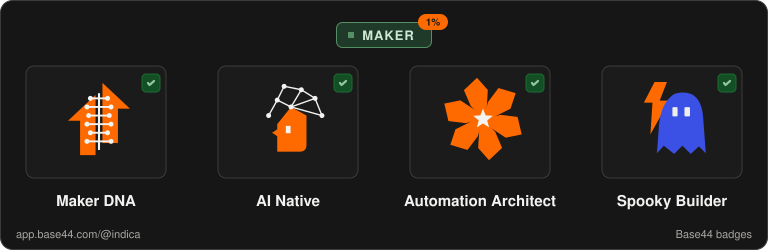
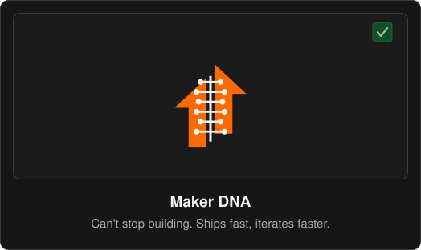
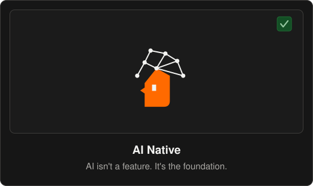
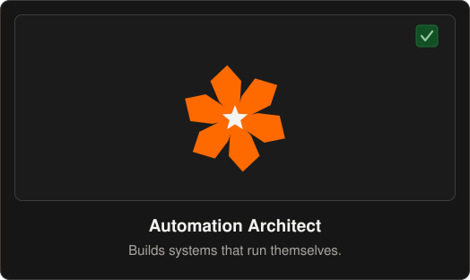

# Base44 badges

Badges earned by **Indica Independent Media** on [Base44](https://app.base44.com/@indica), recreated as clean SVG so they can be shown on GitHub. Everything here links back to the profile where they were earned.

## The badges

| Badge | Name | What it stands for | Claimed |
| :---: | :--- | :--- | :--- |
|  | **Maker DNA** | Can't stop building. Ships fast, iterates faster. | 2026-10-05 |
|  | **AI Native** | AI isn't a feature. It's the foundation. | 2026-10-28 |
|  | **Automation Architect** | Builds systems that run themselves. | 2026-10-05 |

The profile also carries the **Maker** tier mark, shown here as a small green pill above the three badges.

## Full cards

The full versions follow the layout of the cards on the Base44 profile page.

## Files

| Path | What it is |
| :--- | :--- |
| `icons/*.svg` | Icon only, 100 x 100 viewBox, transparent background |
| `cards/*.svg` | Full card with name and description, 524 x 312 |
| `base44-badges-panel.svg` | The compact panel used on the GitHub profile |
| `maker-pill.svg` | The Maker tier pill |
| `build.py` | Generates every file above from one script. Run `python3 build.py` |

Colours were measured from screenshots of the live profile: orange `#FF6A00`, card `#161616`, tile border `#3D3C3A`, claimed mark `#134F25` and `#95C6A0`, Maker green `#568F63`.

## Attribution

The badge program, its names, descriptions and original artwork belong to Base44. The SVGs in this repository are hand-traced recreations made so the badges can be displayed on GitHub, which Base44 does not provide image files for. This repository is not affiliated with or endorsed by Base44. The recreated SVG files are released under the MIT License in this repository.
